# AI workflow note

## Tools used

- **Claude:** helped draft the initial application implementation and first-pass documentation.
- **GitHub Copilot CLI:** helped inspect and refine the implementation, diagnose a sign-in regression from a user-provided screenshot, improve the interface, extend formatting support, and add regression coverage.

## Workflow

```mermaid
flowchart LR
    Prompt[Assignment requirements] --> Draft[AI-assisted first draft]
    Draft --> Inspect[Read the code and inspect the running app]
    Inspect --> Decide[Human scope and product decisions]
    Decide --> Implement[Small implementation changes]
    Implement --> Test[Run automated tests and local smoke checks]
    Test --> Review[Inspect UX evidence and refine]
    Review --> Deliver[Document remaining limitations honestly]
```

## Where AI accelerated the work

AI helped scaffold the Express/SQLite API, the initial editor UI, file converters, HTML sanitization, test suite, and documentation. Follow-up work used AI to quickly iterate on workspace layout and add starter templates, title search, local favorites, duplicate, print, writing statistics, word-processor-style formatting controls, and a more readable default document size.

## Judgment retained by the developer

- Kept the application build-free and used Node’s built-in SQLite rather than adding a framework or hosted database for this time-boxed assignment.
- Kept authentication explicitly mocked and sharing limited to known demo users; this is easy for reviewers to exercise but is not production security.
- Kept access enforcement server-side and added allow-list HTML sanitization rather than trusting the browser.
- A screenshot showed demo accounts missing from the login screen with a stale cookie. The public user-list route was corrected and a regression test added.
- Rich text styles needed sanitizer changes. Only constrained color, highlight, alignment, and font-size values are now accepted; other CSS is removed.
- Formatting and UI output were reviewed against the app’s existing API and test behavior rather than accepting generated changes without verification.

## Verification and remaining checks

`npm test` passes seven automated tests covering permissions, validation and sanitization, safe style persistence, upload/conversion, stale-cookie demo-account loading, database-directory initialization, and export access. The local HTTP smoke check confirmed that the static page and demo-user endpoint respond successfully. A person should still manually check text selection formatting, sharing in two browser sessions, and the deployed Render service. Deployment and persistent hosted storage have not yet been verified.
