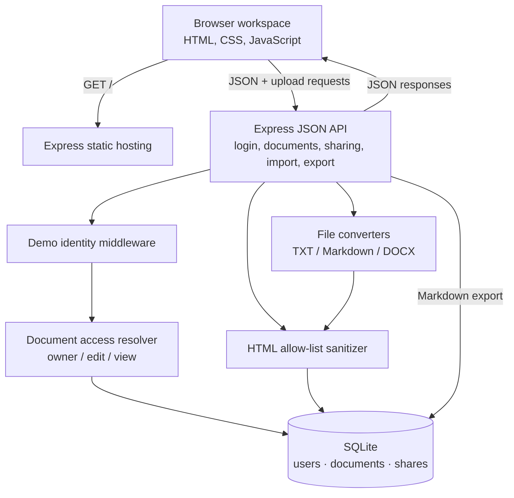
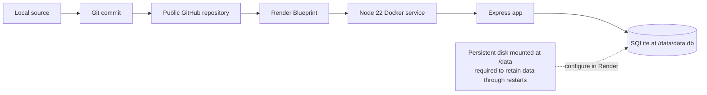

# Architecture

## System overview

Ajaia Docs is a single-process Node.js application. Express serves the static browser UI and JSON API; SQLite stores seeded demo users, documents, and document shares. There is no frontend build step, external API, or required paid software dependency.



## Source map

| Path | Responsibility |
|---|---|
| `public/index.html` | Responsive workspace, formatting toolbar, editor, templates, search, dialogs, browser-local preferences |
| `src/server.js` | Starts the Express app and selects the SQLite file |
| `src/app.js` | SQLite schema, seeded users, authentication simulation, document API, access checks, upload and export endpoints |
| `src/convert.js` | Plain-text/Markdown/DOCX conversion, HTML sanitization, Markdown export |
| `test/api.test.js` | Automated API, permission, conversion, persistence, and sanitization tests |
| `Dockerfile`, `render.yaml` | Container build and Render Blueprint |

## Document lifecycle and access

```mermaid
sequenceDiagram
    actor Writer
    participant UI as Browser editor
    participant API as Express API
    participant Guard as Role check + sanitizer
    participant DB as SQLite
    Writer->>UI: Create or import a document
    UI->>API: POST /api/docs or /api/upload
    API->>Guard: Validate title / convert and sanitize content
    Guard->>DB: Insert document with owner
    DB-->>UI: Document ID
    Writer->>UI: Edit document
    UI->>UI: Debounce edits; show save state
    UI->>API: PUT /api/docs/:id
    API->>Guard: Resolve owner/editor/viewer; reject unauthorized write
    Guard->>DB: Store sanitized HTML and updated timestamp
    Writer->>UI: Share with a seeded teammate
    UI->>API: POST /api/docs/:id/share
    API->>Guard: Require owner role
    Guard->>DB: Upsert share role
```

The `users`, `documents`, and `shares` tables store identity, document content, and access grants. The server resolves a document role for every document operation. An unshared document is returned as 404, viewers cannot write, and only owners may rename, delete, or manage shares. Editors can update content but cannot change the title.

## Editor and content safety

The browser uses `contenteditable` and the browser’s formatting commands to avoid a frontend dependency/build step. Formatting includes paragraph styles, alignment, selected-text font size, text color, highlight, emphasis, lists, and indentation. Autosave is debounced and reports save status; it is last-write-wins and does not resolve simultaneous edits.

The server sanitizes all editor and imported HTML before persistence. The sanitizer allows only needed structure and tightly constrained styles: supported pixel font sizes, hex/RGB colors, and standard text alignment values. It removes unsupported attributes and CSS. Imported files become new editable documents owned by the uploader.

## Browser-local state

Favorites and the light/dark appearance preference are stored in `localStorage`, scoped by demo account where appropriate. They are convenience features, not server-backed collaboration data. Document content and shares are persisted in SQLite.

## Deployment path



The Render Blueprint creates a free web service but does not provision a disk. A persistent disk mounted at `/data` is required for SQLite data to survive service restarts/redeploys; check the current Render plan and pricing. The Vercel serverless filesystem is ephemeral and is not a drop-in storage solution for this SQLite app.

## Deliberate tradeoffs

- **No real authentication:** seeded demo accounts keep sharing easy to review; the app is not suitable for sensitive or production use.
- **No live collaboration:** saves use last-write-wins, with no history, presence, or conflict detection.
- **Small editor dependency footprint:** `execCommand` is deprecated; a maintained editor should replace it if the product is extended.
- **Conversion is intentionally bounded:** Markdown supports a small subset and DOCX is imported through Mammoth. Export targets that subset; browser print can save a PDF.

## Next engineering steps

1. Add version-aware saves to detect and explain concurrent edits.
2. Replace demo authentication with a secure sign-in and invitation flow.
3. Move to a maintained rich-text editor and add browser end-to-end tests.
4. Consider version history, comments, and real-time collaboration only after the core product is reliable.
