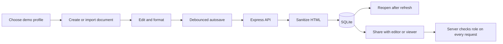

# Ajaia Docs

**A considered workspace for writing, organizing, and sharing team documents.**

Ajaia Docs is a full-stack product slice created for the Ajaia Full Stack Product Engineer assignment. It brings a focused document editor, file import, simple collaboration permissions, and persistent storage together in a build-free Node.js application.

> **Assignment status:** Core product features and automated tests are implemented. The public source repository is available at [github.com/Asijain019/ajaia-docs](https://github.com/Asijain019/ajaia-docs). The product still needs to be deployed and the walkthrough recorded by the submitter.

## At a glance

| | |
|---|---|
| **Stack** | Node.js, Express, SQLite, vanilla JavaScript |
| **Requirements** | Node.js 22.13+, npm |
| **Editor** | Rich text, formatting, autosave, templates |
| **Import** | `.txt`, `.md`, `.docx` · 5 MB maximum |
| **Collaboration** | Owner, editor, and viewer roles |
| **Run locally** | `npm ci` then `npm start` |

## Start locally

Open PowerShell in the repository folder:

```powershell
cd ajaia-docs
npm ci
npm start
```

Visit [http://localhost:3000](http://localhost:3000). Keep that terminal open while using the app. To stop the server, press **Ctrl+C**.

Run the automated tests from a second terminal in the same folder:

```powershell
npm test
```

No frontend build step is required. The server uses Node’s built-in `node:sqlite`.

| Environment variable | Default | Description |
|---|---:|---|
| `PORT` | `3000` | HTTP port |
| `DB_FILE` | `./data.db` | SQLite database file |

## Try the sharing flow

Sign-in is simulated for this assignment. Select a seeded profile; no password is required.

| Profile | Demo email |
|---|---|
| Alice Chen | `alice@example.com` |
| Bob Okafor | `bob@example.com` |
| Carol Singh | `carol@example.com` |

1. Sign in as Alice and create or open a document.
2. Select **Share**, enter `bob@example.com`, and grant **Can edit** or **Can view**.
3. Open a private window and sign in as Bob to see the shared document and verify the role.

The demo accounts are not real users. Do not store private or sensitive information in this application.

## Product capabilities

- Create, rename, edit, autosave, reopen, duplicate, and delete documents.
- Format selected text with bold, italic, underline, font sizes, text colors, and highlight colors.
- Set paragraph styles and left, center, right, or justified alignment; use lists, indentation, undo, and redo.
- Import `.txt`, `.md`, and `.docx` files into editable documents. The UI and server enforce the 5 MB limit.
- Share with an existing demo user as editor or viewer. Owners can change or revoke access.
- Search document titles and favorite documents in the current browser.
- Start from meeting notes, project brief, or weekly update templates.
- Switch light/dark appearance, see word and character counts, print/save through the browser, or export Markdown.
- Persist document content and sharing records in SQLite; sanitize editor HTML on the server.

Markdown conversion intentionally supports a subset of Markdown syntax. Favorites and appearance preferences are local to the browser and account.

## How the document flow works



## Deploy on Render

The repository includes a Dockerfile and a Render Blueprint file. Render is the intended path for this Express + SQLite app; Vercel’s ephemeral serverless filesystem is not a drop-in fit for the local SQLite database.

1. Push the repository to GitHub. The current public source repository is [Asijain019/ajaia-docs](https://github.com/Asijain019/ajaia-docs).
2. In Render, choose **New → Blueprint**, connect that repository, and deploy the detected `render.yaml`.
3. Wait for the service to finish deploying, then open its `onrender.com` URL and try the Alice/Bob sharing flow.
4. The container is configured to store SQLite at `/data/data.db`. For data to survive service restarts or redeploys, attach a persistent disk mounted at `/data` using a Render plan that supports disks. Check the current plan and disk pricing in Render before enabling one.
5. Add the final live URL to `SUBMISSION.md` and your Google Drive submission folder.

The included Blueprint uses the free web-service plan and does **not** create a persistent disk. Without a disk, SQLite data may be lost when the service restarts or redeploys. The public demo login is not real authentication; do not treat this deployment as a production or private-document service.

### Push later changes to GitHub

From PowerShell in the project folder:

```powershell
git add .
git commit -m "Describe the update"
git push origin master
```

## Automated checks

`npm test` runs six tests covering document access and sharing roles, validation and HTML sanitization, safe rich-text style persistence, Markdown import and conversion, public demo-account loading (including stale cookies), and Markdown export access.

## Known limitations and next steps

**Working:** document editing and persistence, supported formatting, file import, demo sharing roles, search, templates, favorites, duplicate, printing, Markdown export, and six automated tests.

**Incomplete:** real authentication, external invitations, simultaneous-edit conflict handling, real-time collaboration, version history, comments, hosted deployment verification, and the recorded walkthrough.

**Next:** replace the simulated account selector with real authentication and invitations; add version-aware saves; move to a maintained editor; add browser end-to-end tests.

## Assignment handoff

The other required submission notes are intentionally separate files:

- [Architecture note](ARCHITECTURE.md) — system overview and Mermaid architecture diagrams.
- [AI workflow note](AI_WORKFLOW.md) — tools, judgment, and verification.
- [Submission checklist](SUBMISSION.md) — included deliverables and the links you still need to add.

The walkthrough URL placeholder file has been removed as requested. After recording your video, create a `VIDEO_URL.txt` containing its unlisted URL and add it to the source/Drive folder. Add screenshots or a short GIF only if your final deployed setup needs special reviewer instructions.
